# ER図（Mado）

Mado のデータ構造（論理モデル）と、データに関するルール。

- ログインはGoogleアカウントだけ
- 表示用の端末も、普通にログインして使う（ログイン状態は、使っているあいだ延長する）
- 画面では1人1ボード（初回のテンプレート選択で作る）。データは、1人が複数のボードを持てる形にしておく
- ウィジェット本体と設定はボード共通。配置（位置・サイズ・ページ）だけを表示先ごとに持つ
- 同じ種類のウィジェットは、1つのボードに1つまで
- ToDoの項目やメモの本文は、ウィジェットに属する（表示先をまたいで共有される）
- カレンダーは iCal URL を購読する

## 図に載せる列の基準

- 主キー・外部キーと、設計の決定を表す制約は載せる
- 画面に表示する列、画面の動きに使う列は載せる
- 実装の都合で必要な列は載せない（下の「図に載せていない列」を参照）

型はPostgreSQLの型で書いているが、実装時にスキーマ（Drizzle）を書くときに見直す。実際の型・インデックスまで含む詳しい図（物理モデル）は、実装後にDBから自動で作る。

```mermaid
erDiagram
  users ||--o{ accounts : "連携したGoogleアカウント"
  users ||--o{ sessions : "ログイン中"
  users ||--o{ boards : "持つ"
  boards ||--o{ widgets : "置く（種類ごとに1つまで）"
  widgets ||--o{ widget_placements : "表示先ごとの配置"
  widgets ||--o{ todo_items : "ToDoの項目"
  widgets ||--o| memos : "メモの本文"
  widgets ||--o{ calendar_subscriptions : "購読するiCal"
  widgets ||--o{ news_feeds : "登録したフィード"

  users {
    text id PK
    text name "ユーザー名（Googleの表示名が初期値）"
    text email UK "Googleアカウントのメールアドレス"
    text image "プロフィール画像のURL"
    timestamptz terms_accepted_at "利用規約に同意した日時。NULLなら確認画面へ"
    timestamptz created_at "マイページの「登録日」"
  }
  accounts {
    text id PK
    text user_id FK
    text provider_id "google（今はGoogleだけ）"
    text account_id "Google側のユーザーID"
    text scope "許可された範囲（カレンダー連携で使う）"
  }
  sessions {
    text id PK
    text user_id FK
    timestamptz expires_at "使っているあいだは延長する"
    timestamptz created_at "退会前の本人確認に使う"
  }
  verifications {
    text id PK
    text identifier
    text value "Googleログインの途中で使う一時的な値"
    timestamptz expires_at
  }
  boards {
    uuid id PK
    text user_id FK
    text name "リビング など"
    integer sort_order "ボード切り替えの並び順"
  }
  widgets {
    uuid id PK
    uuid board_id FK "type と組み合わせて一意"
    widget_type type "clock / weather / calendar など"
    jsonb settings "表示設定（種類ごとに形が違う）"
  }
  widget_placements {
    uuid widget_id PK, FK
    display_target display_target PK "pc / tablet_portrait など"
    smallint page "スマホ縦の2ページ目など"
    smallint x
    smallint y
    smallint w
    smallint h
  }
  todo_items {
    uuid id PK
    uuid widget_id FK
    text title
    boolean is_done
    integer sort_order
  }
  memos {
    uuid widget_id PK, FK
    text body
    timestamptz updated_at "「2時間前」の表示に使う"
  }
  calendar_subscriptions {
    uuid id PK
    uuid widget_id FK
    text name
    bytea url_encrypted "iCalの非公開URL（暗号化して保存）"
    text color "予定の色分け"
    timestamptz last_fetched_at "「10:28 更新」の表示に使う"
    text last_error "「取得できません」の表示に使う"
  }
  news_feeds {
    uuid id PK
    uuid widget_id FK
    text title
    text feed_url
    integer sort_order "ドラッグで並べ替え"
    timestamptz last_fetched_at "「10:28 更新」の表示に使う"
    text last_error "「取得できません」の表示に使う"
  }
```

`users` / `accounts` / `sessions` / `verifications` は、Better Auth（Googleログイン）が使うテーブル。`verifications` は他のテーブルとつながっていない。Googleログインの途中で使う一時的な値（state など）を、Better Auth が保存するテーブル。

## 図に載せていない列

| 列 | 理由 |
|---|---|
| `created_at` / `updated_at` | 全テーブルに持つ。画面や処理で使うもの（`users.created_at`、`sessions.created_at`、`memos.updated_at`）だけ図に載せている |
| Better Auth の内部用の列（Googleのトークン類、メールアドレスの確認状態、セッションのIPアドレス・ブラウザの情報など） | Better Auth が決める列で、アプリの設計の対象ではない。実装時に公式のスキーマに合わせる |

Better Auth の標準のスキーマにない列は、`users.terms_accepted_at`。追加する方法は実装時に確認する。

## 線の端の記号

| 記号 | 意味 |
|---|---|
| 縦線2本（`\|\|`） | ちょうど1 |
| 丸と縦線（`o\|`） | 0または1 |
| 丸と三つ又（`o{`） | 0以上（多） |
| 縦線と三つ又（`\|{`） | 1以上（多） |

例：`boards ||--o{ widgets` は「1つのボードに、ウィジェットが0個以上ある」。

## 決まった値の一覧（enum）

**widget_type（ウィジェットの種類）**

| 値 | 意味 | settings に入るもの |
|---|---|---|
| clock | 時計 | 表示形式、秒・日付の表示、文字のスタイル、世界時計の都市 |
| weather | 天気 | 地域（緯度・経度・名前）、表示する情報、温度の単位、背景、更新間隔 |
| calendar | カレンダー | 表示する内容（月表示・今日・明日）、週の始まり、更新間隔（購読先は calendar_subscriptions） |
| todo | ToDo | 完了した項目の表示、完了した項目を下に移動するか（項目は todo_items） |
| memo | メモ | 文字の大きさ、背景の色（本文は memos） |
| countdown | カウントダウン | イベント名、日付、日付のあとに表示する言葉、表示する単位、進み具合のバーの表示 |
| news | ニュース・RSS | 表示件数、画像の表示、見出しの自動送り、更新間隔（フィードは news_feeds） |

**display_target（表示先）**

| 値 | 表示先 | グリッド |
|---|---|---|
| pc | PC・モニター 16:9 | 4×3 |
| tablet_landscape | タブレット横 | 4×3 |
| tablet_portrait | タブレット縦 | 3×4 |
| sub_display | 横長サブディスプレイ | 6×2 |
| phone_portrait | スマホ縦 | 2×4（ページあり） |
| phone_landscape | スマホ横 | 4×2 |

グリッドの列×行はDBに持たず、コードの定数にする。

## 制約とルール

**ボードとウィジェット**

- `widgets`：`(board_id, type)` に一意制約。同じ種類のウィジェットは、1つのボードに1つまで
- 一覧からウィジェットを置くとき、その種類の `widgets` のレコードがすでにあれば、新しく作らずに `widget_placements` のレコードだけを追加する（前の中身と設定のまま戻る）。なければ `widgets` と `widget_placements` を両方作る
- `widget_placements`：主キーは `(widget_id, display_target)`。レコードがなければ、その表示先では「未配置」。`widgets` のレコード自体がなければ、一覧では印なし（まだ追加していない）
- ツールバーの「外す」は、その表示先の `widget_placements` のレコードだけを削除する。ウィジェットと中身（ToDoの項目、メモ、カレンダーの購読先など）は残る
- ウィジェットを削除する操作はない。`widgets` のレコードは、ボードやユーザーを削除したときだけ一緒に消える（ON DELETE CASCADE）。中身を消したいときは、設定パネルで項目や購読先を1つずつ削除する
- 配置の重なりや、グリッドからはみ出していないかは、APIのサービス層でチェックする
- `todo_items` / `memos` / `calendar_subscriptions` / `news_feeds` は、種類が合うウィジェットにだけ紐づける（サービス層でチェックする）

**ログインとアカウント**

- `accounts`：`(provider_id, account_id)` に一意制約。1つのGoogleアカウントは、1人のユーザーにだけ紐づく
- `users.terms_accepted_at` が NULL のユーザーは、初回ログインの確認画面（ユーザー名・利用規約への同意）に進ませ、同意するまでダッシュボードを使えないようにする
- 確認画面で「キャンセルしてログアウト」を押したユーザーは、すぐに削除する（`accounts`・`sessions` もまとめて削除）。タブを閉じるなどして同意しないまま残ったユーザーは、次のログインで確認画面に戻す
- ログイン状態は、使っているあいだ期限を延ばす（表示用の端末が、表示している途中でログアウトしないように）
- 退会は、本人確認（Googleでの再ログイン）の直後だけ受け付ける。ログインしたばかりかどうかは `sessions.created_at` で判断する

**全体**

- アプリのデータはすべて `widgets → boards → users` とたどれる。他人のデータを読み書きできないよう、APIでこの経路の所有者を確認する
- ユーザーを削除すると、ボード以下のデータ・セッションもまとめて削除する（ON DELETE CASCADE）

## DBに持たないもの

| データ | 置き場所 |
|---|---|
| テンプレート（ベーシック、スタンバイなど） | コードの定数 |
| 表示先ごとのグリッドの大きさ | コードの定数 |
| 端末で固定した表示先 | 端末のブラウザ（localStorage） |
| 編集モードで最初に開く表示先 | 持たない。今の画面の大きさに合う表示先から開く |
| テーマ（ダーク・ライト） | 持たない。端末の設定（`prefers-color-scheme`）に従う |
| iCalの予定、RSSの記事 | キャッシュ |

初回の設定で選んだ地域は、天気ウィジェットの `settings` に入れる。
